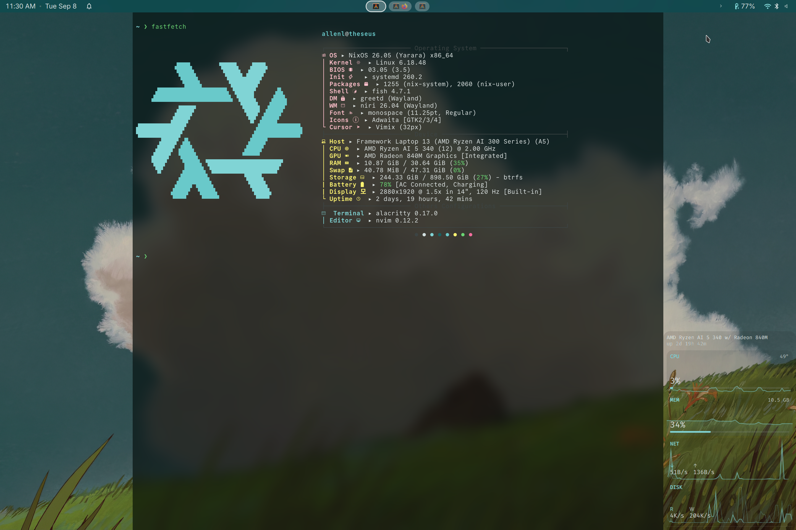

# Nix-Config
My NixOS and Home-Manager Configs



## Features
**Standalone** home-manager modules (*: config is [external](#related)).
| Feature | Component |
|---|---|
| Shell | [Fish](https://fishshell.com)\*, [Starship](https://starship.rs)\* |
| Editor | [Neovim](https://neovim.io)\* |
| WM | [Niri](https://niri-wm.github.io/niri/)[⌃](/home/_modules/de/niri) |
| Desktop Shell | [Dux Modular Shell](https://duxlabs.dev/)[⌃](/home/_modules/de/dms) |
| Theming | [Matugen](https://iniox.github.io/#matugen)[⌃](/home/_modules/matugen.nix) |
| Terminal | [Kitty](https://sw.kovidgoyal.net/kitty/)[⌃](/home/_modules/app/kitty.nix), [tmux](https://tmux.app/)\* |
| Launcher | [Vicinae](https://www.vicinae.com/)[⌃](/home/_modules/app/vicinae.nix) |
| Browser | [Firefox](https://www.firefox.com)[⌃](#firefox-based-browsers) |
| File Manager | [Coil.nvim](https://github.com/allen-liaoo/coil.nvim)\* |
| PDF Viewer | [Sioyek](https://sioyek.info/)[^](/home/_modules/app/sioyek.nix) |
| Video Player | [mpv](https://mpv.io/)[^](/home/_modules/app/mpv.nix) |


**Self-Hosted** \*arr stack, Jellyfin services via [nixarr](https://nixarr.com/) [⌃](host/barrybenson/services).

**Nix-Specific**
- Secrets management via [sops-nix](https://github.com/Mic92/sops-nix) [⌃](host/_modules/sops.nix),[⌃](home/_modules/sops.nix).
- Declarative disks partitioning via [disko](https://github.com/nix-community/disko/) with BTRFS and LUKS [⌃](host/theseus/disko.nix).
- Wipe storage on boot via [impermanence](https://github.com/nix-community/impermanence) [⌃](host/_modules/fs/impermanence.nix).

## Structure
```
home/
_modules/ - modules for home-manager
<username>/ - HM users
host/
  _modules/ - modules for nixos
  <hostname>/ - nixos hosts
inventory/ - metadata of users, hosts and valid pairings (see section below)
secrets/ - sops-nix secrets
shell.nix - decShells for the repo, including distinct neovim instances and dev env for home/ and host/
```

### Self-Gating Modules
Modules in `_modules` are self gating, meaning they determine if they should be enabled or not by looking at the context.
This is different from how they're usually implemented, where hosts and users conditionally import modules or "presets", and one needs to carefully maintain lists of imports. 
Consequently, modules are always wholly imported, and most `default.nix` on modules just import every file in its directory and every
`default.nix` in subdirectories.

### Project Location in any system
It is required that the project is cloned to `~/nix-config` when using the Home-Manager modules.
This allows symlinking out of store files to work correctly, and sidesteps file permission issues.

## Hosts
| Name | Hardware | Type | Note | Status |
|---|---|---|----|---|
|theseus|Framework Laptop 13 (Ryzen AI 5 340)|laptop|My daily driver. NixOS + LUKS + everything in dots.|✅|
|barrybenson|Beelink Mini PC (Ryzen 7 5700U)|server|Headless homeserver with impermanence. Containers setup in progress.|✅|


✅ Setup completed | 
🚧 In progress | 
📝 Planning

## Details

### Secrets
- Each NixOS host generates a ssh host key on initial install, which is used to derive the host age key (on boot). The age key is then used to decrypt host secrets. 
- For each user of a NixOS host, the host decrypts the user's password for its own setup, and the user's age key to a location that the home-manager sops expects (`~/.config/sops/age/key.txt`).
  The user's home manager config then uses the age key to decrypt secrets.

### Firefox-based Browsers
My firefox (HM) module configs can be applied to any firefox-based browser, such as `floorp`, `librewolf`, or even `glide` (from external flake). 
For examples, see [firefox.nix](home/_modules/app/browser/firefox.nix) and [glide.nix](home/_modules/app/browser/_glide.nix).
Both share these centralized configs: 
- [firefox/config](home/_modules/app/browser/firefox/config) - Shared policies, settings, extensions, and my custom module configs
- [firefox/mkModule](home/_modules/app/browser/firefox/mkModule) - My custom modules, which includes:
  - `pywalfox.nix`- for setting up [pywalfox](https://github.com/Frewacom/pywalfox) (colors and system theming) native messaging host and extension
  - `wavefox.nix` - for setting up [WaveFox](https://github.com/QNetITQ/WaveFox) (ui styling)

The shared configs and custom modules are meant to be merged with firefox-based browser modules such as `programs.firefox`, `programs.librewolf`, etc.

## Related
- [nvimx](https://github.com/allen-liaoo/nvimx) - My modular Neovim distribution via NixVim.
- [alnpkgs](https://github.com/allen-liaoo/alnpkgs) - My nix packages and wrapper modules (I use it to package my [shell](/home/_modules/shell/aln-shell.nix) and its dependencies).
